# Modular Forge RAG Starter

[](https://github.com/BugraCinar/modular-forge-rag-starter/actions/workflows/ci.yml)

A modular RAG service shared by [Modular Forge FastAPI](https://github.com/BugraCinar/modular-forge-fastapi-starter) and [Modular Forge Spring Boot](https://github.com/BugraCinar/modular-forge-spring-boot-starter).

It ingests documents through a durable worker, retrieves tenant- and ACL-filtered
evidence, and returns answers with document/chunk citations. Provider ports keep
embedding, generation, extraction and reranking replaceable. SQLite runs the
offline demo; PostgreSQL + pgvector supports deployment. OpenAI and Ollama are
opt-in adapters. No provider calls or credentials are needed for the demo/tests.

```mermaid
flowchart LR
  UI[Browser / mobile] --> B[FastAPI or Spring Boot backend]
  B --> A[Validate current account and permissions]
  A --> T[60-second backend delegation]
  T --> R[RAG API]
  R --> J[Document + durable ingestion job]
  J --> W[Worker: extract → chunk → embed]
  W --> DB[(PostgreSQL + pgvector)]
  R --> Q[Query embedding + ACL-filtered hybrid retrieval]
  DB --> Q
  Q --> RR[Optional reranker + context budget]
  RR --> G[Grounded generation]
  G --> V[Validate citation IDs + recheck access]
  V --> B
```



## Quick start

Python 3.11–3.14; install [uv](https://docs.astral.sh/uv/getting-started/installation/).

```sh
uv sync --frozen --all-extras
uv run --frozen --all-extras forge-rag init-env
uv run --frozen --all-extras forge-rag migrate
uv run --frozen --all-extras forge-rag demo
uv run --frozen --all-extras uvicorn forge_rag.app:create_app --factory --host 127.0.0.1 --port 8090
```

In a second terminal, run the ingestion worker:

```sh
uv run --frozen --all-extras forge-rag worker
```

`demo` exercises enqueue → worker → retrieval → cited answer in one process.
The hash embedder and extractive generator are deterministic development tools,
not semantic embeddings or an LLM. Select real providers for semantic QA.

## Use with your backend

Install the removable [FastAPI integration](integrations/fastapi/README.md) or
[Spring Boot integration](integrations/spring-boot/README.md). Both expose
`/api/v1/rag/*` through the existing backend, use its current-account validation,
and sign a separate short-lived delegation. Browser clients never receive a RAG
service key. Samples use a private per-account tenant; replace the membership
resolver to share an organization knowledge base. Never take tenant/group claims
from the browser.

| Operation | Internal RAG endpoint | Scope |
|---|---|---|
| Enqueue/update document | `POST /v1/documents`, `Idempotency-Key` required | `rag:write` |
| Processing status | `GET /v1/jobs/{id}` | `rag:write`, owner only |
| Document metadata | `GET /v1/documents/{id}` | `rag:read`, document ACL |
| Delete source, chunks, queued payload | `DELETE /v1/documents/{id}` | `rag:write`, owner only |
| Retrieve evidence | `POST /v1/search` | `rag:read` |
| Answer with citations | `POST /v1/query` | `rag:read` |
| Enabled modules | `GET /v1/modules` | `rag:read` |

Document JSON includes `external_id`, `dataset`, `title`, `content`, `media_type`,
and optional `read_subjects`/`read_groups`. PDFs use Base64 content and the `pdf`
extra/toggle. Plain text and Markdown use literal UTF-8 text. Arbitrary URL
fetching, OCR and Office extraction are intentionally separate future adapters.

```json
{"external_id":"returns-policy","title":"Returns","content":"Returns are accepted within 30 days.","dataset":"default"}
```

```json
{"question":"When are returns accepted?","dataset":"default","top_k":5}
```

## Configuration and deployment

`forge-rag init-env` creates random, distinct backend delegation keys in `.env`.
Copy only the relevant key into each backend's secret store; do not reuse its
user JWT key. See [.env.template](.env.template), [operations](docs/OPERATIONS.md),
[security boundaries](docs/SECURITY.md), and [provider setup](docs/PROVIDERS.md).
Schema changes use versioned migrations; API/worker startup never creates tables.

```sh
docker compose up --build
```

Compose is a local PostgreSQL demo, binds the API to loopback and keeps the DB
private. Production needs TLS, backups, capacity limits, a gateway with per-user
rate/spend quotas, isolated parser workers, and your own domain-specific evals.
This starter does not claim factual correctness merely because a citation ID
exists. Paid provider adapters are tested with mocked HTTP, not live credentials.

## Modules and verification

See [module catalog](docs/MODULES.md), [modular plan/removal rules](docs/MODULAR_PLAN.md),
[architecture](docs/ARCHITECTURE.md), and [Türkçe uçtan uca pipeline](docs/PIPELINE_TR.md).

```sh
uv run --frozen --all-extras ruff check .
uv run --frozen --all-extras ruff format --check .
uv run --frozen --all-extras mypy src
uv run --frozen --all-extras pytest
uv run --frozen --all-extras forge-rag evaluate
uv run --frozen --all-extras pip-audit --local --skip-editable
uv run --frozen --all-extras python -m build
```

CI also runs real PostgreSQL/pgvector contracts, Java integration tests, installed
wheel smoke tests and Docker builds. CC0-1.0, consistent with the sibling starters.
