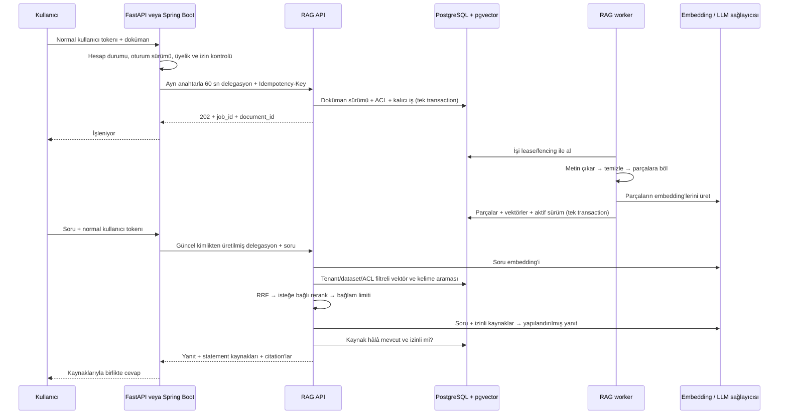

# FastAPI + Spring Boot + RAG: uçtan uca akış

Bu proje iki backend'in ortak kullanabileceği ayrı bir RAG servisidir.
Kullanıcı, sipariş, abonelik ve organizasyon gibi iş kuralları mevcut backend'de;
doküman işleme, embedding, arama ve kaynaklı cevap üretme RAG servisinde kalır.
Backend'lerin aynı anda kullanılması şart değil; her biri tek başına bağlanabilir.

## 1. Veriyi RAG'e nasıl sokarsın?

Örneğin uygulamada bir iade politikası, ders notu veya şirket dokümanı oluştu.
Backend `POST /api/v1/rag/documents` alır, normal kullanıcı doğrulamasını yapar,
sonra yeni repodaki gateway modülüyle RAG'in `POST /v1/documents` uç noktasına
iletir. Dokümanın iş sistemindeki sabit kimliğini `external_id` olarak kullanırsın.
Her oluşturma/güncelleme olayı için ayrı, tekrar denemelerde değişmeyen bir
`Idempotency-Key` verirsin: örneğin `policy-123-version-4`.

202 yanıtı indeks hazır demek değildir. Job sorgulanır; worker metni çıkarır,
sayfa/karakter konumlarını koruyarak böler, embedding üretir ve bütün parçaları
tek işlemde yayınlar. Worker kapanırsa iş kaybolmaz, lease süresi dolunca alınır.
Hatalı PDF kalıcı hata; geçici sağlayıcı hatası sınırlı yeniden deneme oluşturur.
PDF'nin metin katmanı yoksa OCR adaptörü gerekir; mevcut PDF modülü OCR yapmaz.

## 2. Soru nasıl cevaplanır?

Frontend yalnızca mevcut backend'e gider. RAG'in servis anahtarını tarayıcıya
koymazsın. Backend'in `current_account` bağımlılığı veya Spring `JwtAuthFilter`
önce kullanıcının hâlâ geçerli olduğunu kontrol eder. Tenant ve gruplar backend
veritabanındaki üyelikten bulunur; istemciden gelen `tenant` alanına güvenilmez.

Soru embedding'e dönüşür. RAG yalnızca bu kullanıcının erişebildiği güncel
dokümanlarda hem vektör hem kelime araması yapar. Adaylar RRF ile birleşir,
isteğe bağlı rerank edilir ve bağlam boyutu sınırlandırılır. LLM'e tüm veritabanı
yerine seçilmiş parçalar gönderilir. LLM kaynak kimlikleriyle cevap verir.
Servis uydurma kaynak kimliğini reddeder ve yanıt öncesi erişimi tekrar kontrol
eder. Yeterli kaynak yoksa `insufficient_evidence` döner.

Kaynak kimliğinin geçerli olması, cümlenin kesin doğru olduğunu kanıtlamaz.
Gerçek veriyle cevap doğruluğu, kaynak desteği ve prompt injection testleri de
gereklidir. Demo modu LLM kullanmaz: anahtarsız test için hash tabanlı kelime
vektörü ve kaynak metinden cümle seçimi kullanır.

## 3. Mevcut iki starter'a bağlantı

- **FastAPI:** `integrations/fastapi` paketini backend ortamına kur,
  app factory'de `install(app)` çağır ve `RAG_MODULE_ENABLED=true` ayarla.
  Mevcut `current_account` doğrulaması doğrudan kullanılır.
- **Spring Boot:** `integrations/spring-boot` içindeki `dev.modularforge.rag`
  paketini ekle, kılavuzdaki property'leri tanımla ve `MODULE_RAG_ENABLED=true`
  ayarla. Mevcut filtrenin doğruladığı immutable ID ve role kullanılır.
- Her backend RAG'in `DELEGATION_KEYS` haritasındaki **kendi ayrı anahtarını** alır.
  Kullanıcı JWT anahtarını tekrar kullanmazsın. Sorguda `rag:read`, doküman yazma
  ve silmede `rag:write` yetkisi verilir.

Varsayılan örneklerde kullanıcı başına özel bilgi alanı vardır. Şirketin ortak
bilgi tabanı için `RagIdentity`/`RagIdentityResolver` implementasyonunu değiştirip
tenant ve grupları kendi üyelik tablonla eşlersin. Python kullanıcısı `42` ve Java
kullanıcısı `42` otomatik olarak aynı kişi sayılmaz; canonical kimlik eşlemesi
senin iş modelinin parçasıdır. Ortak tenant içinde de doküman ACL'si uygulanır.

## 4. Güncelleme, silme ve olay hattı

Aynı `external_id` ve dataset ile yeni içerik gönderildiğinde sürüm artar.
Eski sürüm hemen aramadan çıkar; yeni sürüm hazır olana kadar o doküman için
arama durur. Eski worker yeni sürümün üzerine yazamaz. Silme, metadata/ACL/parça
verilerini kaldırır ve bekleyen işlerin ham içeriğini temizler.

İş veritabanındaki değişikliğin RAG'e mutlaka ulaşması gerekiyorsa, backend'de
**transactional outbox** kullanırsın: iş kaydı ve outbox olayı aynı transaction'da
yazılır, bir relay `document.upsert`/`document.delete` olayını iletir. Mesajı,
RAG enqueue işlemi kalıcı olarak kabul edince onaylarsın. Olay kimliği idempotency
anahtarı olur. Mevcut starter'lardaki after-commit Kafka çağrıları best effort'dür;
tek başına kayıpsız senkronizasyon garantisi vermez. Bu repodaki RAG iş kuyruğu
kalıcıdır, business DB tarafındaki outbox ise uygulamana ayrıca eklenmelidir.

Hesap silme/üyelik değişikliği de backend'in sorumluluğundadır. İlgili dokümanları
sil veya ACL'lerini yeniden gönder. Zaten verilmiş delegasyonun kalan ömrü en
fazla 60 saniyedir. Harici sağlayıcıya daha önce gönderilmiş metin geri alınamaz;
veri sınıflandırmana göre yerel Ollama veya uygun sağlayıcı politikasını seçersin.

## 5. Neleri modüler tutuyoruz?

Extractor, chunker, embedder, repository/vector search, reranker ve generator
portlarla ayrılır. PDF, ingestion API/worker, rerank, telemetry, evaluation ve API
docs kapatılabilir. OpenAI/Ollama yalnızca seçildiğinde yüklenir. Embedding modeli,
boyutu veya chunk ayarı değişince indeks yeniden üretilir; LLM değiştirmek tek
başına reindex gerektirmez. Model takma adı aynı kalıp ağırlıklar değişirse
`EMBEDDING_REVISION` artırılır.

İlk canlı kurulumda PostgreSQL, API ve worker ayrı süreçler olarak başlatılır.
Önüne TLS, kullanıcı bazlı kota, zaman aşımı ve dosya boyutu limitleri koyarsın.
Sonra gerçek soru/kaynak örnekleriyle Recall@k, MRR, kaynak doğruluğu, yanıtsız
sorularda durma, gecikme ve token maliyetini ölçersin. Bu repodaki küçük çevrimdışı
eval bir regresyon kontrolüdür; canlı model kalitesinin ölçümü değildir.
